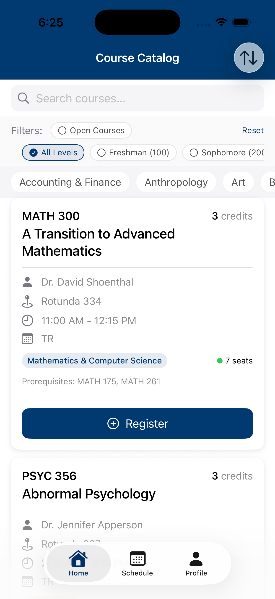

# Longwood class selector

A SwiftUI course-registration prototype with a local sample catalog. Browse courses, inspect prerequisites, register or join a waitlist, and view a weekly schedule. It does not connect to Longwood's registration system.

## App preview



This is the running app in an iPhone 17 simulator on iOS 26.2, captured on 2026-09-12. The build used the committed Xcode project and sample courses.

## Run it

```sh
git clone https://github.com/cadeKukk/longwood-class-selector.git
cd longwood-class-selector
open "longwood class selector.xcodeproj"
```

Select the `longwood class selector` scheme and an iPhone simulator, then run. For a physical device, select your own signing team in Xcode.

## Demo walkthrough

1. Search for `ACCT 240` and open its course details.
2. Review the meeting days, seat count, and prerequisites. Register for the course.
3. Open Schedule to see the course in the weekly grid.
4. Return to Home and use Open Courses or a department filter to narrow the catalog.
5. Open Profile to inspect the sample student and registration summary.

These actions change the prototype's local state. Refresh simulates enrollment changes; it does not fetch the university's live catalog.

## Source map

| Path under `longwood class selector/` | Purpose |
| --- | --- |
| `Model/CourseDataService.swift` | Bundled course records |
| `Model/CourseViewModel.swift` | Registration, filtering, sorting, and waitlist state |
| `Model/Course.swift` | Course and meeting-day types |
| `Views/` | Catalog, course details, schedule, and profile screens |

The project was created for coursework at Longwood University. The university has not endorsed this prototype.
