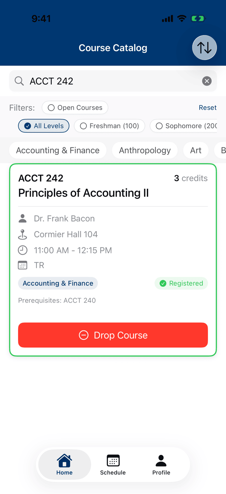
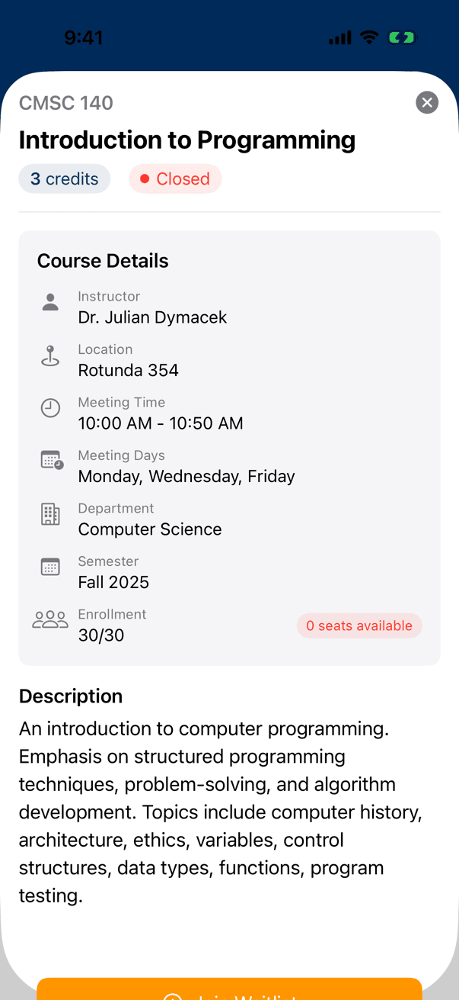
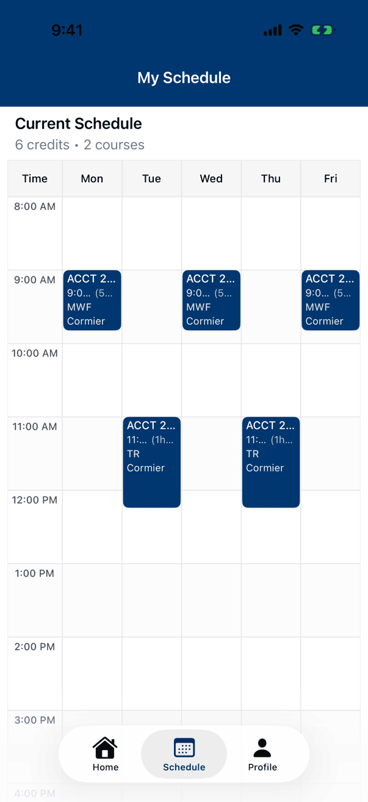
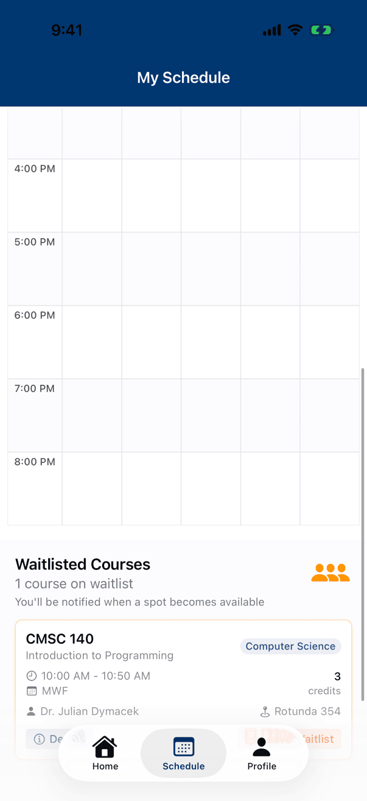

# Longwood class selector

A SwiftUI course-registration prototype with a local sample catalog. Browse courses, inspect prerequisites, register or join a waitlist, and view a weekly schedule. It does not connect to Longwood's registration system.

## App preview

<p>
  
  
  
  
</p>

The running app in an iPhone 17 Pro simulator on iOS 26.5, captured on 2026-11-10 from the committed Xcode project and its sample courses (built with Xcode 27.0). The screens show what the app looks like after registering for ACCT 240 and ACCT 242 and joining the waitlist for CMSC 140, which is full.

## Run it

```sh
git clone https://github.com/cadeKukk/longwood-class-selector.git
cd longwood-class-selector
open "longwood class selector.xcodeproj"
```

Select the `longwood class selector` scheme and an iPhone simulator, then run. The project targets iOS 18.4 or later. For a physical device, select your own signing team in Xcode.

## Demo walkthrough

1. Search for `ACCT 240` and tap Register on its card. Do the same for `ACCT 242`.
2. Search for `CMSC 140`, a full course. Tap the card to open its details, then Join Waitlist.
3. Open Schedule to see both registered courses in the weekly grid; scroll down for the waitlisted one. Tap a course there to drop it, leave the waitlist, or replace a course it conflicts with.
4. Return to Home and use Open Courses, a level, or a department filter to narrow the catalog. Courses that overlap your schedule are marked Time Conflict.
5. Open Profile to inspect the sample student and registration summary.

The catalog is 271 sample courses across 50 departments, all compiled into the app. Registrations live in memory and are gone when the app restarts. Pull to refresh simulates enrollment changes; it does not fetch the university's live catalog.

## Known issues

Found while capturing the screens above:

- The first time you tap a course after launch, on the catalog or the schedule, the details sheet opens blank. Swipe it down and tap again.
- On a full course's catalog card the Join Waitlist button is disabled. Joining works from the course's details sheet.

## Source map

| Path under `longwood class selector/` | Purpose |
| --- | --- |
| `Model/CourseDataService.swift` | Bundled course records |
| `Model/CourseViewModel.swift` | Registration, filtering, sorting, and waitlist state |
| `Model/Course.swift` | Course and meeting-day types |
| `Views/` | Catalog, course details, schedule, and profile screens |

The project was created for coursework at Longwood University. The university has not endorsed this prototype.
